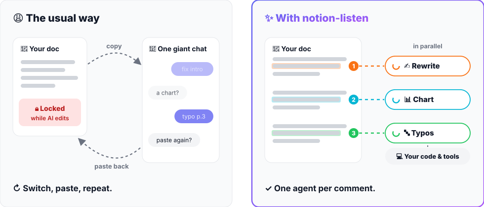
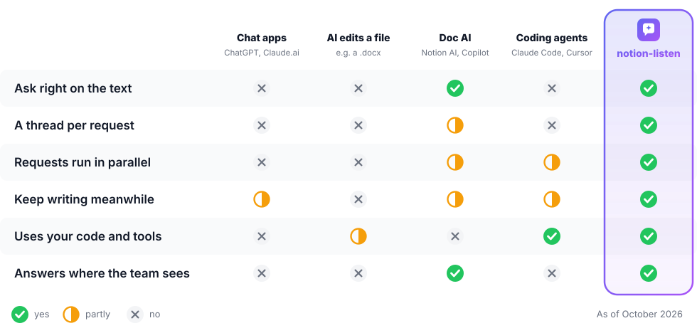

<div align="center">

<picture>
  <source media="(prefers-color-scheme: dark)" srcset="assets/banner-dark.svg">
  
</picture>

[](https://github.com/lanyado/notion-listen/actions/workflows/ci.yml)
[](LICENSE)


[](https://github.com/lanyado/notion-listen/stargazers)

**[Quick start](#quick-start)** · [How it works](docs/how-it-works.md) · [Configuration](docs/configuration.md) · [FAQ](docs/faq.md) · [Troubleshooting](docs/troubleshooting.md)

</div>

https://github.com/user-attachments/assets/9c42d98f-5c06-43f4-87f6-3d87da114a50

Highlight text in Notion and comment. A Claude Code agent **on your machine,
inside your project** does the work and answers in the thread. You never leave
the doc, and you never stop writing.

## Why notion-listen?

No copy-pasting into a chat, no giant thread, no locked document, and an agent
that can actually use your code and tools.

<p align="center">
<picture>
  <source media="(prefers-color-scheme: dark)" srcset="assets/workflow-dark.svg">
  
</picture>
</p>

<p align="center">
<picture>
  <source media="(prefers-color-scheme: dark)" srcset="assets/compare-dark.svg">
  
</picture>
</p>

## Quick start

You need [Node.js 20+](https://nodejs.org), [Claude Code](https://docs.claude.com/en/docs/claude-code)
(claude.ai login or Console API key) and a free [ngrok](https://ngrok.com/download) account.

```bash
curl -fsSL https://raw.githubusercontent.com/lanyado/notion-listen/main/install.sh | bash
```

Using an AI agent? Point it at [INSTALL.md](INSTALL.md).

The installer runs a five-minute setup wizard. Then share a page with your
integration (**••• → Connections**) and start listening from your project:

```bash
cd ~/my-project
notion-listen "https://www.notion.so/My-Page-1a2b3c4d5e6f7a8b9c0d1e2f3a4b5c6d"
```

Claude Code asks you to confirm the development channel: choose **I am using
this for local development**. Then comment on the page, and watch it work.
First run? Type `/mcp` in Claude Code and sign in to **notion** so the agent can
edit pages.

## Usage

```
notion-listen <page-url>           Listen to a page from the current folder
notion-listen setup                Change settings
notion-listen doctor [page-url]    Check that everything is ready
notion-listen stop                 Stop the background webhook services now
notion-listen update               Update to the latest version
```

More pages? Run it again in another terminal, one page each, and close any of
them whenever you like. Settings live in `~/.config/notion-listen/config.env`. See
[Configuration](docs/configuration.md) to change permissions, tone and replies.
Something off? Run `notion-listen doctor`, then see
[Troubleshooting](docs/troubleshooting.md).

## Security

Comments become instructions to an agent that can edit your files, so only
people you choose can give them. Webhooks are signature-checked, and shell
commands always ask you first. See [SECURITY.md](SECURITY.md).

## Contributing

Ideas and pull requests are welcome: see [CONTRIBUTING.md](CONTRIBUTING.md).
Built on [Claude Code channels](https://code.claude.com/docs/en/channels),
[MCP](https://modelcontextprotocol.io), the [Notion API](https://developers.notion.com)
and [ngrok](https://ngrok.com).

[MIT](LICENSE) © Rotem Lanyado
