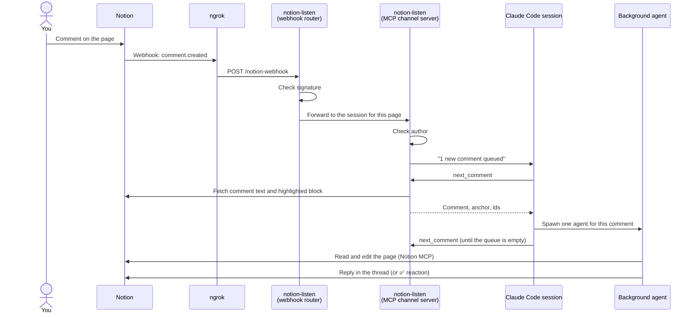
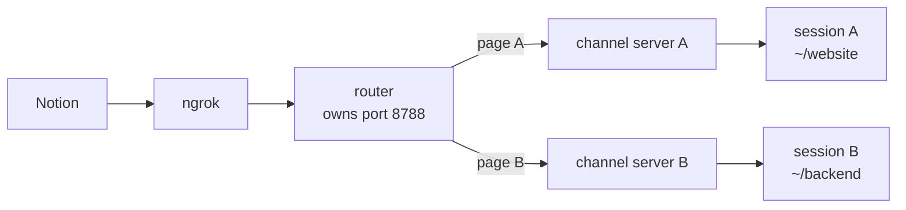

# How it works

notion-listen connects three things you already use: a Notion page, a local
project folder, and a Claude Code session.

## The pieces

**Webhook.** Your Notion integration has a webhook subscription for
`comment.created`. Notion signs every delivery with a
secret it sends once, during verification. notion-listen stores that secret and
rejects anything without a valid signature.

**Tunnel.** Notion needs a public HTTPS URL, so ngrok forwards
`https://<your-domain>/notion-webhook` to `localhost:8788`. A static ngrok
domain keeps the URL stable, so you verify the webhook once and never touch it
again.

**Router.** `src/router.ts` owns port 8788 and receives every webhook. It
checks the signature and forwards each event to the session bound to that
page. One router serves all your sessions (see
[Several pages at once](#several-pages-at-once)).

**Channel server.** `src/channel.ts` is an [MCP](https://modelcontextprotocol.io)
server that Claude Code starts for the session, using Claude Code's *channels*
feature. It registers its page with the router, drops its own replies and
comments from people who aren't allowed, and queues the rest. It then sends
the session a short "comments are waiting" notice.

**Dispatcher session.** The Claude Code session you started acts as a
dispatcher. It pulls comments one at a time with `next_comment` and hands each
to a background agent. This keeps the session's own context small, and a slow
task never blocks newer comments. The dispatcher's rules are in
[`prompts/dispatcher.md`](../prompts/dispatcher.md).

**Workers.** Each background agent reads
[`prompts/worker.md`](../prompts/worker.md) and then handles one comment. It
fetches only the blocks around the highlight, makes the change through the
hosted Notion MCP server, checks the result, and reports back. Follow-ups in the
same thread, or on the same paragraph, go to the agent that already knows that
context.

**Model choice.** Each comment comes with a suggested model. Short or trivial
comments get a fast model, ordinary edits a balanced one, and structural or
page-wide work ("restructure", "everywhere", "compare") the strongest one. The
logic is in `suggestModel` in [`src/lib.ts`](../src/lib.ts).

## Several pages at once

Run `notion-listen <page-url>` in as many terminals as you like, one page each.
The first one starts the router and the ngrok tunnel in the background, and
later ones share them. Each channel server keeps a connection open to the
router, so the router always knows which sessions are alive, however they
ended. A minute after the last session closes, the router stops ngrok and
exits. `notion-listen stop` does that right away.

## What gets written where

| Path | Contents |
|---|---|
| `~/.config/notion-listen/config.env` | Your settings and secrets (permissions `600`) |
| `~/.config/notion-listen/*.md`, `claude-settings.json` | Your own copies of the prompts or permissions, if you [customized them](configuration.md#agent-behavior) |
| `~/.local/state/notion-listen/` | Logs, the router's socket, and per-page summaries |
| `<project>/.mcp.json` | The listener's MCP server entry. Other servers in the file are kept |
| `~/.notion-listen/` | The installed code, replaced on `notion-listen update` |

When a session starts, notion-listen also makes sure Claude Code hasn't switched
off its MCP servers for that folder. If you once declined the "new MCP server
found" prompt, the channel would otherwise never start. It switches them back on
for the session and restores your choice when the session ends.
